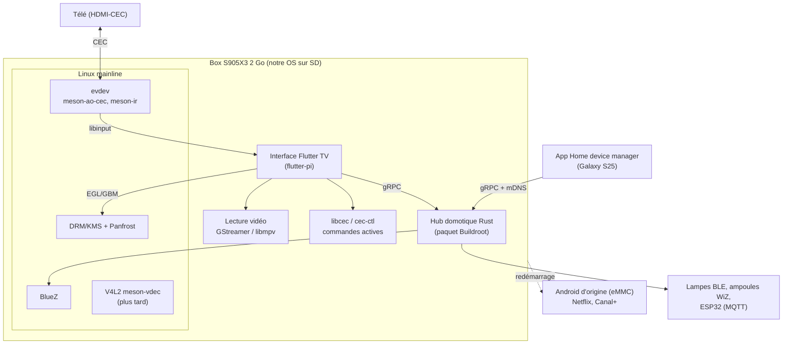

# Architecture

## Vue d'ensemble

## Composants

| Composant | Rôle | Où vit le code | ADR |
|---|---|---|---|
| Image système | Linux minimal Buildroot, démarre depuis la SD via le u-boot d'origine | `buildroot/` (phase 3) | 0004, 0006 |
| Affichage | DRM/KMS + Mesa Panfrost + GBM/EGL, sans X11 ni Wayland | config Buildroot | 0007 |
| Interface | App Flutter « 10 pieds » plein écran via flutter-pi, trois onglets (Regarder, Ambiance, Réglages) | `ui/` (phase 2) | 0008, 0013 |
| Entrées | CEC et infrarouge exposés en evdev, lus par flutter-pi via libinput | config noyau + keymaps | 0009 |
| Vidéo | GStreamer (lecteur intégré à flutter-pi) ou libmpv | `ui/` + Buildroot | 0010 |
| Mises à jour | A/B avec RAUC | `buildroot/` (phase 6) | 0011 |
| Hub domotique | Service Rust (tokio, bluer, WiZ, MQTT), gRPC + mDNS | `payssho/Home-device-manager`, empaqueté ici | 0012 |
| Prévisu de l'interface | Build web de l'app, page hôte avec télécommande | `ui/`, `scripts/previsu/` | 0015 |
| Banc mémoire 2 Go / 4 Go | Conteneurs Docker bornés, vrais programmes | `scripts/emulation/` | 0016, 0017 |
| Garde-fous de stockage | `/data` séparée, plafonds de caches, nettoyage nocturne, alerte | `buildroot/` (J6, J9) | #45 |

## Flux principaux

1. **Démarrage** : u-boot de l'eMMC → script `s905_autoscript` sur la SD → noyau mainline + DTB → init → flutter-pi lance l'interface. Priorité à la **fiabilité** : chaque démarrage doit arriver sur l'interface, avec un retour automatique à l'image précédente si une mise à jour ne démarre pas (ADR 0011). Ensuite seulement, on raccourcit la durée (cible indicative : 15 s).
2. **Touche de télécommande** : télé → CEC → `meson-ao-cec` → evdev → libinput → flutter-pi → `Shortcuts`/`Actions` Flutter. L'infrarouge suit le même chemin via `meson-ir` et `rc-core`.
3. **Allumer la télé** : interface → `cec-ctl`/libcec → message CEC « Image View On ».
4. **Lumières et télécommande depuis le téléphone** : l'app Home device manager trouve la box en mDNS et parle au hub en gRPC : lampes, ambiances, et commandes de la télé (lancer une app, naviguer, volume, Bluetooth…, #46). Sur la télé, l'onglet Ambiance applique un préréglage de la pièce par le même chemin : interface → gRPC local → hub → BLE ou UDP.
5. **Netflix** : bouton « redémarrer sous Android » → la box redémarre sur l'eMMC (phase 4). Le mécanisme peut écrire l'environnement u-boot sur l'eMMC une fois celle-ci sauvegardée (ADR 0018).
6. **Maintenance** : la nuit ou quand la télé est en veille, nettoyage des caches au-delà des seuils (#45) et maintenance mémoire ; jamais pendant une lecture ni quand l'accueil est affiché (ADR 0017).

## Décisions

Voir l'[index des ADR](adr/README.md).
