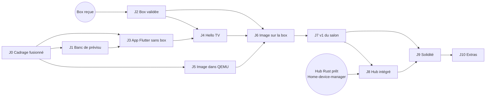
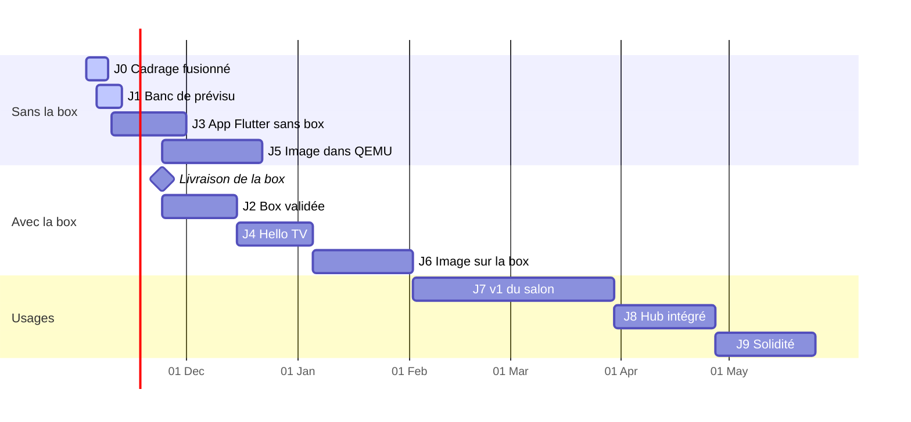

# Plan de réalisation

Ce plan découpe la construction de l'OS complet en **jalons**. Chaque jalon se termine par une démo vérifiable et regroupe des issues existantes. Il complète la [roadmap](roadmap.md) (le « quoi » de chaque phase) avec le « dans quel ordre, avec quelles dépendances, et quand ». L'état réel reste dans les issues GitHub : ce fichier se révise à la fin de chaque jalon, pas à chaque PR.

Établi le 2026-11-06. Box HK1 S905X3 4/32 Go commandée le 2026-11-03, réception estimée entre le 17 et le 28 novembre.

## Hypothèses

- **Capacité** : Marius seul, environ 8 h par semaine (soirées et week-ends), plus l'agent pour le code, les docs et la CI. Les durées sont en semaines calendaires et donnent une fourchette, pas un engagement.
- **Tests** : tout ce qui se teste sans la box se teste sans elle (maquette, Flutter web et desktop, QEMU). Marius teste sur la vraie télé et rapporte.
- **Builds lourds** : en GitHub Actions ou sous WSL2 chez Marius (CLAUDE.md).
- **Règles inchangées** : jamais d'écriture sur l'eMMC sans accord, aucun contournement de DRM, un ADR par choix structurant.

## Vue d'ensemble (Now / Next / Later)

| Horizon | Jalons | Ce qu'on voit à la fin |
|---|---|---|
| **Now** (novembre) | J0 Cadrage fusionné · J1 Banc de prévisu · J3 App Flutter sans box | L'interface se discute et se teste dans Claude, sans la box |
| **Next** (décembre à février) | J2 Box validée · J4 « Hello TV » · J5 Image dans QEMU · J6 Image sur la box | La télé démarre sur **notre** interface depuis la SD |
| **Later** (mars à juin 2027) | J7 v1 du salon · J8 Hub intégré · J9 Solidité · J10 Extras | La phrase de la [vision](vision.md#résultat-attendu-de-la-v1) est vraie tous les soirs |

## Dépendances

**Chemin critique** : réception de la box → J2 → J4 → J6 → J7. Tout ce qui ne dépend pas de la box (J1, J3, J5) avance avant, pour que la box arrive sur un terrain prêt.

## Calendrier indicatif

## Jalons

### J0. Cadrage fusionné (phase 0)

- **Objectif** : le dépôt suffit à reprendre le projet.
- **Livrables** : PR #37 fusionnée (docs, 14 ADR, CI, checklist phase 1), milestones créées avec `scripts/github/creer-milestones.sh`.
- **Fin** : CI verte sur `main`, issues rangées par milestone.
- **Issues** : #1, #2, #3.
- **Durée** : quelques jours. **Dépend de** : la relecture de Marius.

### J1. Banc de prévisu de l'interface (phase 2, sans box)

- **Objectif** : voir et piloter l'interface dans Claude avant d'écrire le Flutter, et comparer une box 2 Go et 4 Go.
- **Livrables** : [`maquette/banc-interface.html`](../maquette/README.md) publiée comme page Claude : cinq sections (Regarder, Lumières, Ambiance de la pièce, Ambiance de l'OS, Réglages), logos, fond animé (lucioles ou ondes), ambiance « Feu de cheminée » avec son, YouTube, Twitch, mémoire, stockage, dialogue Android ; navigation au focus ; profils 2 Go, 4 Go et côte à côte ; scénario « pire cas » ; carte SD neuve ou après 2 ans, avec ou sans garde-fous.
- **Fin** : Marius valide l'arborescence des écrans et l'identité à 3 m sur la maquette.
- **Issues** : #41. **Durée** : 1 semaine. **Dépend de** : rien.

### J2. Box validée (phase 1)

- **Objectif** : savoir exactement ce que la HK1 reçue sait faire sous Linux mainline.
- **Livrables** : `docs/materiel.md`, rapport de `scripts/materiel/diagnostic.sh`, DTB retenu, mesures mémoire réelles sous Armbian.
- **Fin** : les spikes R1, R3, R4, R5 de la [vision](vision.md#risques-techniques) ont chacun une réponse écrite ; CLAUDE.md à jour.
- **Issues** : #4 à #10, #39, #43 (partie box).
- **Durée** : 2 à 3 semaines après réception. **Dépend de** : la livraison.
- **Si ça casse** : pas de DTB qui marche → essayer les DTB voisins d'ophub (`h96-max`, `x96-max-plus`) ; CEC muet → infrarouge + app du S25 (R3).

### J3. App Flutter TV sans box (phase 2)

- **Objectif** : la vraie app existe, testée en CI, et remplace la maquette comme prévisu.
- **Livrables** : `ui/` (Flutter), thème « veilleuse » copié de Home-device-manager, navigation au focus, écran d'accueil en squelette, build web publié en prévisu à chaque PR.
- **Fin** : `flutter test` vert en CI, la prévisu web se pilote au clavier comme la maquette.
- **Issues** : #11, #12, #42, début de #23.
- **Durée** : 2 à 3 semaines. **Dépend de** : J0 ; J1 pour les écrans validés.

### J4. « Hello TV » sur la box : point de non-retour (phase 2)

- **Objectif** : l'app Flutter tourne en plein écran sur la télé et se pilote à la télécommande.
- **Livrables** : flutter-pi compilé pour la box, app lancée sous Armbian, navigation CEC et IR, ADR qui confirme flutter-pi ou bascule sur `cage`.
- **Fin** : démo sur la télé du salon, 60 images/s sur l'accueil, mémoire de l'interface mesurée.
- **Issues** : #13 à #16. **Durée** : 2 à 3 semaines. **Dépend de** : J2, J3.

### J5. Image Buildroot dans QEMU (phase 3, sans box)

- **Objectif** : notre image se construit en CI et son espace utilisateur démarre dans QEMU.
- **Livrables** : arbre `BR2_EXTERNAL`, defconfig QEMU aarch64, build GitHub Actions avec cache, test de démarrage en CI avec `-m 2G` et `-m 4G`.
- **Fin** : artefact `.img.xz` produit par la CI, rapport mémoire des deux profils en artefact.
- **Issues** : #17, #18, #19, #43 (partie QEMU).
- **Durée** : 3 à 4 semaines, en parallèle de J2. **Dépend de** : J0.

### J6. Notre image démarre sur la box (phase 3)

- **Objectif** : plus d'Armbian : la SD contient notre image, qui arrive sur l'interface.
- **Livrables** : noyau mainline et DTB de la box, amorçage depuis la SD via le u-boot d'origine, flutter-pi et l'app empaquetés, partition `/data` séparée et premiers plafonds de stockage (#45).
- **Fin** : démarrage sur l'accueil en moins de 15 s, Android d'origine intact sur l'eMMC.
- **Issues** : #20, #21, #22, début de #45. **Durée** : 3 à 4 semaines. **Dépend de** : J2, J4, J5.

### J7. v1 du salon (phase 4)

- **Objectif** : les quatre usages prioritaires depuis notre accueil (ADR 0014).
- **Livrables** : accueil final avec les logos des apps et le fond animé, lecteur vidéo, YouTube en Chromium kiosque, Twitch natif, bouton « redémarrer sous Android », télé allumée et mise en veille en CEC.
- **Fin** : une soirée entière sans clavier ni souris ; YouTube 2 h sans saturation mémoire sur la box ; fond animé à 60 images/s sur l'accueil (30 en mode sobre) et en pause pendant la vidéo.
- **Issues** : #23, #24, #25, #26, #33, #38.
- **Durée** : 6 à 8 semaines. **Dépend de** : J6. #33 demande l'accord de Marius (écriture de l'environnement u-boot sur l'eMMC).

### J8. Hub intégré (phase 5)

- **Objectif** : piloter la maison depuis la télé, et piloter la télé et la maison depuis une seule app sur le S25.
- **Livrables** : hub Rust dans l'image, écran domotique (celui de la maquette), annonce mDNS, et un écran « Télé » dans l'app Home device manager : lancer une app, naviguer, allumer ou éteindre, régler le fond animé, voir le stockage et vider les caches.
- **Fin** : la lampe du salon change de couleur depuis la télé ; depuis le S25, on lance Twitch sur la télé et on change son fond animé.
- **Issues** : #27, #28, #29, #46. **Durée** : 3 à 4 semaines. **Dépend de** : J7 et le hub dans `payssho/Home-device-manager`.

### J9. Solidité (phase 6)

- **Objectif** : une télé qu'on n'a plus besoin de réparer.
- **Livrables** : racine en lecture seule, mises à jour A/B RAUC avec retour arrière, garde-fous de stockage (nettoyage nocturne, alerte, refus de mise à jour si la carte est pleine), Wi‑Fi si la puce le permet.
- **Fin** : une mise à jour ratée revient seule à la version précédente ; une carte SD remplie artificiellement à 95 % se nettoie seule et l'alerte s'affiche.
- **Issues** : #30, #31, #32, #45. **Durée** : 3 à 4 semaines. **Dépend de** : J7 (J8 conseillé avant).

### J10. Extras (phase 7, au fil de l'eau)

- **Issues** : #34 Widevine L3, #35 recopie d'écran, #36 accès distant, #40 IPTV. À prioriser après J9 selon l'usage réel.

## Ce qui doit être dans la v1 (MoSCoW)

| Priorité | Contenu |
|---|---|
| Indispensable | Démarrage sur notre accueil, navigation télécommande (CEC ou IR), YouTube, Twitch, bouton Android, allumage CEC |
| Important | Domotique depuis la télé, découverte mDNS par le S25, mises à jour RAUC |
| Si le temps le permet | Wi‑Fi, médias locaux, IPTV |
| Pas en v1 | 4K et HDR, Netflix ou Canal+ dans notre OS, Google Cast (vision, hors périmètre) |

## Budget mémoire : 2 Go contre 4 Go

La HK1 commandée a 4 Go. Le profil 2 Go sert à deux choses : savoir si le plan B (box S905X à 1–2 Go, [contexte](vision.md#contraintes)) reste viable, et garder une marge sur 4 Go en concevant l'interface comme si la mémoire était rare.

Estimations de départ (Mo), reprises dans la maquette et à remplacer par les mesures de #43 :

| Composant | 2 Go | 4 Go | Remarque |
|---|---:|---:|---|
| Réservé (CMA vidéo, écran) | 230 | 300 | Dépend du DTB |
| Noyau et système de base | 110 | 110 | Buildroot, sans systemd lourd |
| Interface (flutter-pi + app) | 170 | 170 | Moteur Flutter, tas Dart, textures |
| Miniatures en cache | 64 (16 pendant Chromium) | 192 | Politique « sobre » sur 2 Go |
| Hub domotique Rust | 30 à 70 | 30 à 70 | 70 pendant un scan Bluetooth |
| Chromium sur youtube.com/tv | 560 | 720 | Un seul processus de rendu |
| Chromium après 2 h | +600 | +600 | Croissance observée sur les télés à suivre en mesure |
| Lecteur GStreamer (Twitch 1080p) | 150 à 210 | 150 à 210 | Tampons HLS |
| Mise à jour RAUC en fond | 120 | 120 | Phase 6 |
| tmpfs (`/tmp`, journal en RAM) | 48 | 96 | Plafonné à 128 / 256 Mo |

Lecture : en soirée normale, 2 Go passent (environ 900 Mo libres sous YouTube). Dans le pire cas (2 h de YouTube, mise à jour en fond, scan Bluetooth), il reste moins de 200 Mo sur 2 Go : zram s'active, l'image saccade, puis Chromium risque d'être tué. Sur 4 Go il reste plus de 1,8 Go.

Règles qui en découlent, valables même sur 4 Go :

1. Chromium tourne avec un seul processus de rendu et se ferme au retour à l'accueil.
2. L'interface libère ses miniatures pendant qu'une app plein écran tourne.
3. zram activé dans l'image (J6), avec Chromium désigné en premier pour l'OOM.
4. Les mises à jour RAUC ne s'appliquent pas pendant une lecture.

## Stockage dans la durée

Notre OS vit sur la carte microSD de 32 Go (environ 29,7 Go utilisables) ; l'eMMC reste à Android. La quantité de RAM ne change presque rien au stockage : les deux profils ont la même carte. Elle change seulement la taille des caches qu'on choisit de plafonner et celle du tmpfs. Le vrai risque, sur 2 Go comme sur 4 Go, ce sont les caches et les journaux **sans limite**, qui grossissent en silence et usent la carte.

Estimations (Go), reprises dans la maquette :

| Poste | Neuve | 2 ans sans limites | 2 ans avec garde-fous (2 Go / 4 Go) |
|---|---:|---:|---:|
| Démarrage + système A et B (RAUC) | 2,25 | 2,25 | 2,25 |
| Caches Chromium, données YouTube, miniatures | 0,15 | 13 | 0,7 / 1,1 |
| Journaux et rapports de plantage | 0,02 | 7 | 0,06 |
| Mises à jour téléchargées | 0 | 1,6 | 0,45 pendant un téléchargement |
| Base du hub | 0,01 | 0,5 | 0,1 |
| **Remplissage** | **8 %** | **82 %** | **10 à 13 %** |

Sans garde-fous, la carte n'est pas pleine en quelques semaines, mais elle approche de la saturation en un ou deux ans, et une mise à jour RAUC qui ne trouve plus de place échoue. Garde-fous retenus (#45), posés dès l'image J6 et complétés en J9 :

1. **Racine en lecture seule, `/data` à part** (f2fs, `noatime`) : seule `/data` peut grossir, le système ne casse jamais à cause d'elle.
2. **Plafonds par profil** : cache disque Chromium 256 Mo (2 Go) ou 512 Mo (4 Go), cache de miniatures en LRU 150 ou 300 Mo, journal persistant 64 Mo, rapports de plantage désactivés hors débogage.
3. **Rien d'éphémère sur la carte** : `/tmp` en tmpfs plafonné (128 ou 256 Mo selon la RAM), pas de swap sur la SD (zram seulement), tampons vidéo en RAM.
4. **Nettoyage chaque nuit** : au-delà de 75 % les caches sont vidés ; au-delà de 90 % la télé affiche une alerte et refuse de télécharger une mise à jour.
5. **Mises à jour sûres** : RAUC ne télécharge que s'il reste deux fois la taille du bundle, et le supprime après installation.
6. **Visible et réglable** : écran Réglages > Stockage sur la télé et dans l'app du S25, avec « Vider les caches ».

Les médias locaux (phase 7) n'iront pas sur cette carte : clé USB, disque ou NAS.

## Visuel : logos et fond animé

- **Logos** : les tuiles affichent l'icône de chaque app. La maquette utilise des pictogrammes dessinés ; l'app Flutter embarquera les icônes officielles en assets (usage personnel dans un lanceur, comme n'importe quelle télé).
- **Organisation** : un rail de cinq sections à gauche (Regarder, Lumières, Ambiance de la pièce, Ambiance de l'OS, Réglages), le contenu à droite. Ce qu'on regarde, la lumière, l'ambiance et le paramétrage ne se mélangent plus.
- **Ambiance de la pièce** : des écrans plein écran pour le salon, à commencer par un feu de cheminée avec son crépitement, la lampe qui vacille en ambre (via le hub) et une minuterie qui éteint tout. Dans l'app Flutter, le son sera un fichier en boucle ou une synthèse comme dans la maquette.
- **Fond animé** : un motif original lié à l'identité « veilleuse », des lucioles dans les herbes hautes (par défaut) ou des rubans de lumière, en couleur naturelle ou teintés par la lampe du salon. Il s'inspire de l'ambiance des menus de consoles sans en copier aucun.
- **Budget** : rendu à demi-résolution puis agrandi, en pause dès qu'une vidéo ou Chromium est à l'écran, version allégée sur 2 Go (moins de lignes, 30 images/s), coupé si `prefers-reduced-motion` ou réglage « Arrêt ». Critère de J7 : l'accueil reste à 60 images/s sur la box avec le fond actif.
- L'app Flutter et son fond animé avancent dans le fil dédié à l'interface ; ce plan fixe seulement les contraintes.

## Banc de prévisu de l'interface

Trois étages, du plus léger au plus fidèle :

1. **Maquette HTML (J1)** : [`maquette/`](../maquette/README.md), publiée comme page Claude. Marius demande un changement dans le fil, l'agent modifie le fichier et republie à la même adresse. Elle simule la navigation, le fond animé, un modèle mémoire et le remplissage de la carte SD, pas le processeur.
2. **Build web de l'app Flutter (J3, #42)** : la vraie app, compilée en web avec CanvasKit embarqué, publiée en artefact de CI à chaque PR et republiable comme page Claude. Un sélecteur de profil en mode debug active la politique « sobre ».
3. **Mesure réelle (J2, J5, #43)** : la box elle-même bridée à 2 Go par `mem=2G` sur la ligne de commande du noyau (fichier de démarrage sur la SD, jamais l'eMMC), et notre image dans QEMU avec `-m 2G` et `-m 4G` en CI.

## Rituels

- **Fin de jalon** : démo sur la télé (ou sur le banc pour J1, J3, J5), courte rétro dans `docs/journal.md`, révision de ce plan et de la roadmap.
- **Chaque PR** : une issue, `Closes #n`, CI verte, ADR si un choix structurant est fait.
- **Glissement** : si un jalon du chemin critique dépasse sa fourchette haute, on coupe du périmètre dans J7 (MoSCoW) plutôt que de pousser toutes les dates.
